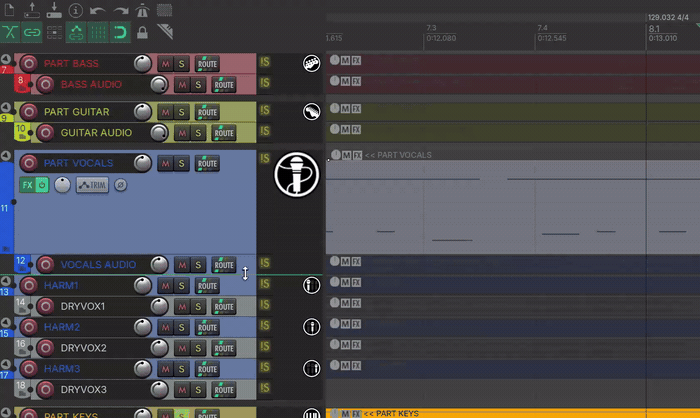
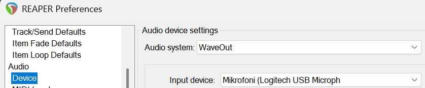
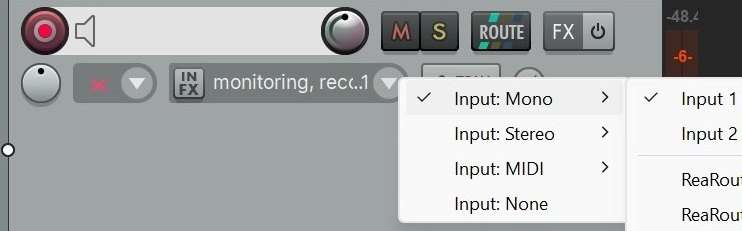
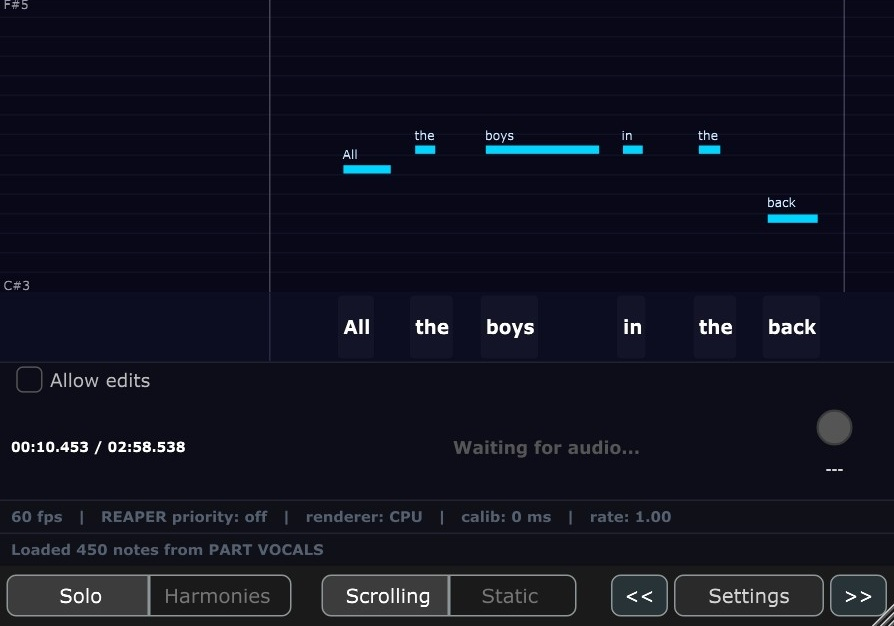

# RB Vocal Sing

**A VST3 plugin for visualizing, testing, and editing Rock Band vocal charts inside REAPER.** It draws a scrolling note highway synced to the REAPER transport — so you can see how the chart will look in the game, sing into your mic to test that the notes and lyrics line up, and edit note pitches by dragging them right on the highway (or by editing in REAPER, with the highway following along live).

This is a **charting tool**, not a competition-grade scorer. The goal is to help you place notes and lyrics correctly — not to replicate the polished scoring engine inside Rock Band itself.

Built for Rock Band-style vocal authoring: it reads `PART VOCALS` (Solo) or `HARM1`/`HARM2`/`HARM3` (Harmonies) straight from your live REAPER project and follows your edits as you make them.



---

## Requirements

- [REAPER](https://www.reaper.fm/) **5.x or later** (the primary, fully-featured host; tested on REAPER 7)
- A VST3-capable DAW if you want to run it elsewhere (degraded — see [Using inside REAPER vs other DAWs](#using-inside-reaper-vs-other-daws))
The plugin is VST3 only.

---

## Installation

1. Download `Rock Band Vocal Sing - Reaper.vst3` from the [GitHub Releases](../../releases) page. (If no prebuilt release is available, or you want the latest, see [Building from source](#building-from-source).)
2. Copy `Rock Band Vocal Sing - Reaper.vst3` into your VST3 folder — on Windows that is `C:\Program Files\Common Files\VST3`.
3. In REAPER: **Options → Preferences → Plug-ins → VST → Re-scan**, or just restart REAPER.
4. Add **RB Vocal Sing** as an FX on a track (see [Setting up the plugin](#setting-up-the-plugin)).

---

## Quick start

1. Open the REAPER project whose vocal chart you want to work on. It should contain a `PART VOCALS` track (for Solo) or `HARM1`/`HARM2`/`HARM3` tracks (for Harmonies).
2. Add **RB Vocal Sing** to a track that is monitoring your microphone (see below). The plugin auto-detects the chart tracks by name — no file to load.
3. Enable **input monitoring** on that track (the speaker icon) so your mic audio reaches the plugin.
4. Press play. The highway scrolls, the chart notes drift past the playhead, and a white arrowhead shows the pitch you are singing.
5. Watch the traffic light in the stats panel: **green** when you are on the note, **yellow** when you are close, **red** when you are off.

The chart reloads automatically whenever you edit, undo, or change tempo in REAPER.

---

## Setting up the plugin

The plugin pitch-detects **whatever audio REAPER feeds into its input** — independent of which track holds the chart (that is read separately via the REAPER API). Where you place the plugin determines what it listens to.

### The primary use case: live mic monitoring

#### Step 1 — Tell REAPER which hardware mic to use

Open **Options → Preferences → Device** and set **Input device** to your microphone. This is a global setting — REAPER uses this device for all track inputs.



#### Step 2 — Route that mic to the track

1. Create a **new, empty audio track**. The plugin pitch-detects everything on its track, so for pure mic input the track should have **no audio or MIDI items** on it.
2. Click the **input selector** in the track header (the small dropdown below the record-arm button) and choose **Input: Mono → Input 1**. This selects the first channel of the input device you set above — for a single USB mic that is the mic itself.



#### Step 3 — Enable monitoring and add the plugin

3. Enable **input monitoring** on the track (the speaker icon). **Record-arm alone is not enough** — monitoring is what routes the mic audio into the plugin. Whether you are actually recording (⏺) makes no difference to pitch detection.
4. Add **RB Vocal Sing** to that track's FX chain.
5. In the plugin's **Settings**, tick **Live-mic used**. This tells the plugin your voice arrives late by the round trip out to your ears and back, so it lines your detected pitch up with the chart. Leave it off whenever the plugin is listening to playback instead (a stem or a recorded take) — that audio has made no such trip. It makes no difference until you set an **Output calib** value.
6. Press play and sing.

> **Tip — never record yourself by accident.** In the track's record-mode dropdown (next to the record-arm button) choose **Record: disable (input monitoring only)**. The track still feeds your mic to the plugin for pitch detection, but a global record will never capture your singing onto it.

### Other placements

| Where you put the plugin                          | What it pitch-detects                                                                                                                                                            |
| ------------------------------------------------- | ------------------------------------------------------------------------------------------------------------------------------------------------------------------------------- |
| On a mic-monitored audio track                    | Your live voice (the primary case above).                                                                                                                                       |
| On a MIDI/synth track (e.g. with ReaSynth)        | Depends on FX order: **before** the synth → the track's audio input (mic, or silence if not monitoring); **after** the synth → the synth's audio output.                        |
| On an audio track with a recorded vocal take      | The recorded samples. Useful for offline review — play back a take and see how it matched the chart without singing live.                                                       |

---

## Using inside REAPER vs other DAWs

REAPER is the primary host. The plugin also loads in other VST3 DAWs, but the experience is degraded — there is no live REAPER API, so the chart cannot be read from the project or follow your edits. In that case it loads from a `.mid` file you pick instead.

|                          | Inside REAPER (primary)                                          | Other DAWs / standalone (fallback)                          |
| ------------------------ | --------------------------------------------------------------- | ----------------------------------------------------------- |
| Chart source             | Live project tracks, read automatically via the REAPER API      | A `.mid` file you pick with the **Load MIDI File** button   |
| Track selection          | Auto: `PART VOCALS` (Solo) or `HARM1`/`HARM2`/`HARM3` (Harmonies), by name | Same names, matched against track-name events in the `.mid` |
| Live edits               | Auto-reloads on any project change (edit, undo, tempo)          | Static — re-pick the file (or toggle Vocal Mode) to refresh |
| **Load MIDI File** button | Hidden (not needed)                                            | Shown                                                       |
| Transport time           | REAPER play / edit cursor                                       | Host playhead                                               |
| Mic pitch detection      | Identical                                                       | Identical                                                   |

In non-REAPER hosts, export your vocal tracks to a `.mid` file with the track names preserved, click **Load MIDI File**, and pick it. Switching Vocal Mode re-reads the same file.

---

## The interface



From top to bottom:

| Area                    | What it shows                                                                                                                                                  |
| ----------------------- | ------------------------------------------------------------------------------------------------------------------------------------------------------------- |
| **Top lyric strip**     | Harmonies only — the shared HARM2 + HARM3 lyrics above the highway.                                                                                            |
| **Note highway**        | The scrolling chart. Notes move right-to-left; the playhead is fixed at 30% from the left. A white arrowhead marks your live detected pitch.                   |
| **Bottom lyric strip**  | The Main (HARM1 / Solo) lyrics, below the highway.                                                                                                             |
| **Allow edits / Save take** | A row above the stats panel. **Allow edits** lets you drag notes on the highway to change their pitch; **Save take** writes the sung pitch trail to a new MIDI track (both REAPER only — see [Editing note pitches](#editing-note-pitches) and [Saving a take as MIDI](#saving-a-take-as-midi)). |
| **Stats panel**         | The project time from REAPER's transport, your live pitch (note name, MIDI number, Hz), and the traffic light.                                                 |
| **Status bar**          | Faint diagnostics: `N fps \| REAPER priority: on/off \| renderer: CPU/GPU \| calib: X ms`.                                                                     |
| **Message bar**         | The chart status (e.g. "Loaded N notes from …"). Turns into an amber ⚠ warning if frames start dropping.                                                       |
| **Control bar**         | Vocal Mode, Lyric Mode, transport buttons, and the **Settings** button — see [Controls](#controls).                                                            |

### The note highway

- Notes scroll at the **Note Speed** rate (default 200 px/sec) with the playhead fixed at 30% from the left.
- In Harmonies mode, parts are colour-coded: **Main cyan**, **Harm2 amber**, **Harm3 brown**. Where a lower part sits on the same sustained pitch as a higher one, its bar is drawn thicker so the overlap stays visible.
- Lane grid lines mark every 2 semitones. The vertical range auto-fits the loaded notes (± 2 semitones of padding).
- The white arrowhead tracks your sung pitch at full (cents) precision, so slides and scoops glide smoothly. When you are within the **Pitch Tolerance** of an active note it locks onto that note's lane — steady green light, steady arrow.
- As you sing a note correctly, the sung portion of its bar **fills gold** (talkie columns get a faint gold wash on any voiced sound). Stop and scroll around — the gold stays so you can review how the take went, no matter how you move the cursor or what else you tweak in the project. It clears when the next pass starts (playing again after a stop or a seek; each lap of a repeat loop also starts clean); editing a note clears just that note's gold.
- A faint white **pitch trail** draws the contour you actually sang — raw pitch, no snapping — so scoops, drift and wobble are visible against the bars. It breaks across silences, follows the same clear-on-new-pass rule as the gold, and stays up while stopped: together they show *whether* each note was hit and *what* was sung. A stopped trail can also be kept for good — see [Saving a take as MIDI](#saving-a-take-as-midi).
- Inline lyric labels on the bars are **Main-only**; HARM2/HARM3 lyrics live in the top strip.
- **Muted MIDI notes are not treated specially** — a note muted in the REAPER MIDI editor still draws and scores like any other. If you don't want a note charted, delete it or move it to another track. (Let us know if muting matters to your workflow — this can be revisited.)
- If no chart is loaded, the highway shows a diagnostic message (including the list of tracks it found, if the lead track is missing).

### Traffic light

The stats panel compares your live pitch to the **closest active chart note of any part**, with cents precision (100 cents = one semitone). How forgiving it is comes from the **Pitch Tolerance** setting (default ± 50 cents):

| Light     | Meaning                                             |
| --------- | --------------------------------------------------- |
| 🟢 Green  | Within the tolerance of the note — you are on it.   |
| 🟡 Yellow | Within twice the tolerance — close.                 |
| 🔴 Red    | Further off than that.                              |
| ⚪ Grey   | No chart note active, or no pitch sung.             |

> **About pitch detection.** The plugin uses the MPM (McLeod Pitch Method) algorithm at roughly 60 estimates per second, with a voicing gate that discards breath sounds, hard consonants and other unpitched audio, and a median filter that suppresses momentary octave errors on note attacks. It is a solid tracker but not infallible — if background noise still triggers spurious pitches, raise the **Mic Gate** in Settings, and if whole notes come out an octave low (common on AI-separated stems), see [Octave Guard](#octave-guard). The traffic light is a charting aid: consistent green across a phrase is a good sign that the notes and lyrics are placed correctly; don't treat individual flickers as a definitive grade.

### Octave Guard

Sometimes the detector lands the right note name in the wrong octave — usually an octave
**too low**. It shows up most on vocals separated out of a finished mix by an AI stem
splitter, whose artifacts make each cycle of the waveform slightly unlike the last.

**Octave Guard** (Settings, default **Off**) surfaces it. When it is on, the plugin also
watches for a competing pitch an octave above the one it reported, and marks the places
where that rival fits the sound almost as well:

| What you see                    | Meaning                                                                 |
| ------------------------------- | ----------------------------------------------------------------------- |
| Red arrowhead / red trail       | The detector is unsure which octave it heard, here.                     |
| `OCT? 88` in the stats panel    | Same, with the rival's strength as a percentage — 100 = a dead heat.    |
| Dim `oct 74` in the stats panel | A rival was noticed but rejected as too weak or too brief. Nothing else marks it; shown so you can see how close the calls are on your material. |
| Dim `oct --` in the stats panel | No competing octave was found here at all. |

**Read red as "not sure", not as "wrong".** A rival peak means the audio is genuinely
ambiguous about its period, and an octave error is only one reason for that. Two harmless
ones are common: a **pitch glide**, where the analysis window spans two notes at once, and
certain **vowels** whose tone colour puts more energy in the second harmonic than the
first. The guard ignores anything lasting under ~64 ms, which filters out most of both,
but the marks are still evidence rather than a verdict. Judge them in context: if the
notes around a red mark are all nearby in pitch, an octave jump there is unlikely and the
mark is a false alarm.

**If a wrong octave goes unmarked, tune the threshold to it.** The number in the chip and
the **Octave Threshold** setting are the same scale, so the adjustment is direct: park on
the note the plugin got wrong, read what the chip says (`oct 78`), and set the threshold
just below it (75). Everything at or above that strength is then marked.

Two things bound how far this goes. A `oct --` reading means no competing octave was found
at all, so the threshold is not the problem and lowering it changes nothing. And above
about **90 %** nothing is ever caught: the detector only picks the wrong octave in the
first place when the right one scored *below* its own internal bar, so a genuine error can
never show a number that high. The useful range is the low-60s to high-80s. Lower settings
catch more, at the cost of more false alarms — especially sustained ones on vibrato or on a
single vowel, which the guard's timing filter cannot remove.

The three modes:

- **Off** — the detector behaves exactly as it does without this feature.
- **Warn only** — marks doubtful spots; changes no pitch. Start here.
- **Warn + correct** — also moves those spots up an octave, in the readout, the traffic
  light, the pitch trail and any take you save. Only use it once **Warn only** has shown
  you the marks land where you would agree with them, since it rewrites pitches based on
  the same judgement.

It cannot detect the opposite error. A peak an octave *below* the reported pitch is
present for any periodic sound, so it carries no information — nothing can be inferred
from it, and the guard does not try.

### Lyric strips

Both strips honour the **Lyric Mode** toggle (Scrolling or Static) and share a gold / white / grey colour scheme. Scrolling mode slides the words along with the highway; Static mode lays them out on the current phrase's grid. If the text is too small (or too large) for your setup, the **Lyrics Size** setting scales both strips. On dense syllable runs, scrolling words can be packed tighter than their text is wide — the **Squash Guard** setting chooses how that overlap is resolved.

---

## Controls

The control bar along the bottom keeps only the things you reach for constantly; everything else lives in a **Settings** popup to keep the window uncluttered.

### Bottom control bar

| Control            | Default   | What it does                                                                                                            |
| ------------------ | --------- | --------------------------------------------------------------------------------------------------------------------- |
| **Vocal Mode**     | Solo      | Solo (`PART VOCALS`) or Harmonies (`HARM1`/`HARM2`/`HARM3`). Switching re-reads the chart; the window grows by one strip in Harmonies. |
| **Lyric Mode**     | Scrolling | Scrolling lyrics (move with the highway) or Static (laid out on the phrase grid).                                      |
| **`<<` / `>>`**    | —         | Jump the playhead back / forward 5 seconds (same as the Left / Right arrow keys).                                      |
| **Settings**       | —         | Opens the settings popup below.                                                                                        |

### Settings popup

Click **Settings** to open these. All of them are saved in the plugin's state, so they come back the way you left them next time.

| Control             | Default          | What it does                                                                                                                                                          |
| ------------------- | ---------------- | ------------------------------------------------------------------------------------------------------------------------------------------------------------------- |
| **Frame cap**       | 60 fps           | Caps the render rate: 20 / 30 / 50 / 60 fps or Uncapped.                                                                                                             |
| **REAPER priority** | off              | When on, the plugin yields render time so REAPER's UI stays responsive under load (it auto-skips frames). When off, it renders as fast as the Frame cap allows.      |
| **Renderer**        | CPU (software)   | How the highway is drawn: **CPU (software)** (default), **OpenGL - session only** (GPU, reverts to CPU next load), or **OpenGL - persist** (GPU, remembered). The status bar shows `renderer: GPU` / `CPU`. OpenGL is experimental — see [Troubleshooting](#troubleshooting). |
| **Output calib**    | 0 ms             | Shifts **the chart** (−200…+500 ms, ±20 ms steps) to compensate for how late the song reaches your ears — your audio output latency. Positive = notes appear later, negative = earlier. Applies only while playing, so parking the edit cursor on a note start always puts that note exactly on the playhead line. The time readout and exported MIDI always use true project time. |
| **Input calib**     | 0 ms             | Shifts **your detected pitch** (−50…+250 ms, ±5 ms steps) to compensate for how late it is measured: your mic/interface input latency plus the analysis window. Raise this until the pitch trail sits on the notes — do **not** use Output calib for that, or the chart drifts off the song. |
| **Live-mic used**   | off              | Tick when singing into a mic: you sing to what you hear, so your voice is late by the output latency as well — **Output calib** gets added to **Input calib** for detection. Leave off when the plugin listens to playback: a vocal stem or a recorded take is already at its true project time and never made that trip. No effect at 0 ms Output calib. |
| **Note Speed**      | 200 px/s         | Scroll rate (100–400 px/s, 25 px steps). Higher = faster, notes more spread out; lower = slower, words pack tighter. Highway and lyrics always share this rate.      |
| **Lyrics Size**     | 100 %            | Scales the lyric-strip text (50–200%, 10% steps). The strips — and the window — grow or shrink to match, so the highway keeps its height. Highway note labels are unaffected. |
| **Squash Guard**    | Off              | What scrolling lyrics do when packed words would overlap: **Spacing** pushes them apart (they glide back as room opens), **Auto-shrink** scales them down (to half size, then condenses), **Hybrid** shrinks a little (≤20%) and pushes the rest. Scrolling mode only — Static lays out whole phrases and never overlaps. |
| **Octave Wrapping** | on               | Wraps your detected pitch by octave to match the chart's range, so singing an octave too high or low still scores against the right note.                            |
| **Pitch Trail**     | on               | Draws the pitch you actually sang as a faint white contour on the highway (raw, no snapping), so scoops and drift are visible. Clears when the next pass starts.       |
| **Pitch Tolerance** | ± 50 cents       | How close to the note you must sing for a green light (± 25 / 50 / 75 / 100 cents; 100 cents = one semitone). Twice the tolerance still shows yellow. Lower = stricter. |
| **Octave Guard**    | Off              | Marks places where the detector is **unsure which octave** it heard — see [Octave Guard](#octave-guard) below. **Warn only** colours them red without changing anything; **Warn + correct** also moves them up an octave. |
| **Octave Threshold**| 80 %             | How strong the competing octave must be before the guard marks it (60–90%, 5% steps). Lower catches more and misfires more. Only used when Octave Guard is on. |
| **Mic Gate**        | —                | RMS threshold (0.001–0.05). Raise if background noise triggers false pitches; lower if quiet singing is ignored.                                                     |
| **Load MIDI File**  | —                | Only shown outside REAPER — pick the `.mid` chart to load.                                                                                                           |

The one setting that does **not** persist is **Renderer = OpenGL - session only**, which deliberately reverts to CPU on the next load (use **OpenGL - persist** if you want the GPU choice remembered).

---

## Moving around the song

The plugin can drive REAPER's transport so you can jump around without leaving the window. **Click the plugin once so it has keyboard focus**, then:

| Input                          | Action                                                                                          |
| ------------------------------ | ----------------------------------------------------------------------------------------------- |
| **Click anywhere on the highway** | Moves the playhead to the time you clicked. (When [edit mode](#editing-note-pitches) is on, clicking *on a note* drags its pitch instead — empty space still seeks.) |
| **Left / Right arrow**         | Jump the playhead back / forward 5 seconds (same as the `<<` / `>>` buttons).                    |
| **Up / Down arrow**            | Speed up / slow down playback — steps REAPER's play rate in 0.1× increments (0.1×–4×). Handy for learning fast passages slowly. |

These all require REAPER (they drive the REAPER transport API) and have no effect in other hosts.

---

## Editing note pitches

You can correct a note's pitch without leaving the plugin — REAPER only.

1. Tick the **Allow edits** checkbox above the stats panel. (It is greyed out if REAPER is not connected, or in a REAPER version without the write API.)
2. On the highway, **drag a note bar up or down**. The pitch snaps to whole semitones as you drag and the bar previews the new position live.
3. Release to commit. The change is written straight into REAPER's MIDI as a single undo step (labelled "Edit vocal note pitch"), so REAPER's Ctrl+Z reverts it.

Only pitch can be changed this way (timing and lyrics are unchanged), and drags are clamped to the singable range so a note can never land on REAPER's reserved marker pitches. With **Allow edits** off, clicking the highway only moves the playhead — so you cannot nudge a note by accident while singing.

---

## Saving a take as MIDI

After singing a pass — or playing a recorded vocal through the plugin — you can keep the take: the **Save take** button next to **Allow edits** writes the pitch trail into your project as real MIDI notes. REAPER only.

1. Sing your pass, then **stop playback**. Stopping freezes the take (the trail and the gold stay on screen), and the button enables.
2. Click **Save take**. A new track named `RB Vocal Sing <date> <time>` appears **directly below the plugin's track**, holding one MIDI item with the notes of your take. The message bar confirms with the note count and track name.
3. The whole export is a single undo step (labelled "Save RB vocal take as MIDI"), so REAPER's Ctrl+Z removes the track again.

What gets written follows the trail on screen, cleaned up for charting:

- Pitches snap to whole semitones, and vibrato or wobble around a note stays one note.
- Blips shorter than ~120 ms (detection spikes, hard consonants) are dropped, and brief unvoiced gaps inside a held note are bridged.
- Notes that would butt against each other get a small gap, so they read as separate notes in the MIDI editor.
- Times are true project time, whatever the calibrations are set to, so the notes line up with the source audio and the chart stays neutral about monitoring latency. Onsets still run slightly late against the waveform — roughly 5 ms starting a phrase and 30 ms on a mid-phrase syllable, because the detector needs enough of the new note inside its ~32 ms analysis window to identify it — so nudge the item left if you need frame-tight alignment. A take sung into a **mic** is later still, by your rig's own round-trip latency; a take read from a **stem** is not.

The button is greyed out while playing, when no take is on screen yet, outside REAPER, and in REAPER versions without the write API. Each save makes a fresh timestamped track — sing, save, tweak, sing again, and keep whichever take reads best.

**Reading the stem while stopped (Stem mode).** Tick **Stem** in the band above the highway and the pitch readout stops listening to your microphone and reads the vocal stem on the plugin's own track instead. Stop the transport, drag the edit cursor through the song, and the note name, Hz, traffic light, arrowhead and octave chip all describe the stem *at the cursor* — no playback, no singing. It is the quickest way to ask "what note is the singer actually on here", and with a chart loaded the arrowhead snaps to the charted note when the stem is within your Pitch Tolerance, so a wrong chart pitch shows up immediately.

Notes on the mode: it reads the track's **media items**, so it is unaffected by any FX on that track, and it needs a REAPER new enough to expose the audio-accessor API (the toggle stays greyed out otherwise). It only applies while **stopped** — during playback the stem reaches the plugin as ordinary audio and the normal path is already correct. Silence, or a gap between items, reads as silence rather than holding the previous note.

**Advanced tuning (expert, off by default).** The **Advanced** button on the second row of the bottom bar opens a panel of detection and segmentation controls for rough material — AI-separated stems, mostly, where letting a little too much through beats missing notes. Everything in it sits behind one **Enable advanced tuning** switch that starts off, and while it is off the plugin uses its standard, tested settings no matter what the sliders say. The sliders grey out to make that obvious. **Restore** puts them back to the shipped values and leaves the switch alone.

| Control | What it does |
| --- | --- |
| **Clarity Gate** | How clean a sound has to be before it counts as a sung note. Lower lets more through — breathy notes, consonants — at the cost of more false pitches. Raise it if a rough stem produces spikes between words. |
| **Min Note Length** | Shortest note **Save take** will keep. Lower it to catch fast syllables, raise it to drop detection blips. |
| **Gap Merge** | Gaps shorter than this inside a held note are bridged instead of splitting it. Raise it if consonants are breaking one word into several notes. |
| **Split Hysteresis** | How far the pitch must move before the export starts a new note. Lower splits more readily; raise it to keep vibrato as one note. |

The **Mic Gate** in Settings is deliberately not repeated here — it applies to every source whether advanced tuning is on or off. And this panel is unrelated to **Live-mic used**: that one answers whether your input is a microphone and adjusts *timing*, nothing else.

**Analysing the whole stem at once (no playback).** With **Stem** ticked and the transport stopped, **Analyse stem** reads the entire vocal stem on this track and fills the pitch trail from it in one pass — no playing, no singing. A progress percentage appears in the message bar and the button turns into **Cancel**; a four-minute stem takes a second or two. When it finishes, the trail on the highway is the singer's melody, and **Save take** writes it out as a reference MIDI exactly as it would a sung pass.

This is the fastest route to a draft chart: load the stem, press Analyse, press Save take, then refine the notes. The sweep stops at the song end (the `[end]` marker on an `EVENTS` track, or the last charted note) so a stray clip parked far down the timeline does not turn a four-minute stem into a twenty-minute scan. It replaces whatever take was on screen, and starting playback part-way through abandons it rather than mixing a half-analysed pass with a sung one.

**Charting from a stem:** put the plugin on a track with the real singer's vocal stem (see "Review takes offline" in [Tips](#tips)), play it through, stop, and save — the exported notes are a draft chart of the actual melody, ready to refine with [note edits](#editing-note-pitches). You do not need any notes on `PART VOCALS` first — with an empty chart the highway draws its axis, playhead and trail across the full singable range, so you can watch the take as it is captured. Leave **Live-mic used** off (the default) while doing this: the export is written at true project time either way, but with it ticked the trail is drawn — and the gold awarded — early against the notes by your Output calib value, so what you see while working would not match what you save.

---

## Tips

- **Monitoring, not record-arm.** The single most common setup mistake — enable the speaker (input monitor) icon on the plugin's track, or the plugin hears silence.
- **Calibrate once for your rig, in this order.** The two calibrations fix two different problems, and using the wrong one trades one misalignment for another.
  1. **Output calib** — does the chart line up with the song? Stop the transport, park REAPER's edit cursor exactly on a note start in the MIDI editor, and check the note sits on the playhead line (it will, since Output calib does not apply while stopped). Now play, and if the notes reach the line before or after you hear them, adjust until they match.
  2. **Input calib** — does your pitch trail line up with the chart? Sing a phrase you know you are hitting, and raise Input calib until the trail sits on the notes rather than trailing behind them. Tick **Live-mic used** so your output latency is counted here too.

  If you find yourself dragging **Output calib** negative to catch a late trail, that is the wrong knob — it drags the whole chart off the song. Use **Input calib**. Neither one moves the time readout or the MIDI that **Save take** writes.
- **Use Note Speed for readability.** If too many notes are crammed on screen, raise Note Speed to spread them out; if words scroll by too fast to read, lower it.
- **Slow down hard passages.** Press the Down arrow to drop REAPER's play rate (e.g. to 0.5×) and sing a tricky run at half speed; Up arrow brings it back. The highway and lyrics stay in sync at any rate.
- **Fix a wrong pitch on the spot.** Spot a note that should be a tone higher? Tick **Allow edits** and drag it — no need to switch to REAPER's MIDI editor. Untick it again before you sing so you can't drag by accident.
- **Review takes offline.** Drop the plugin on a track that already has a recorded vocal item, then play it back — you get the same highway and traffic light without singing live. **Untick Live-mic used** (the default) so the recorded audio is placed at its own time: it made no round trip out to your ears, so applying your Calibration to it would draw the pitch trail early and make an accurate take look wrong. The Calibration value itself can stay where it is — the highway still lines up with what you hear, and so does the arrowhead: with a Calibration set, the plugin has already analysed a fraction of a second more audio than has reached your ears, so the contour stops at the playhead while playing and the last stretch appears when you stop.
- **Harmonies grows the window.** Switching to Harmonies adds the top lyric strip and widens the pitch range to span all three parts, so nothing clips off the top or bottom.
- **Keep it open while authoring.** Inside REAPER the chart reloads on every edit/undo/tempo change, so the highway always reflects the current state of your MIDI.

---

## Troubleshooting

**No notes on the highway / "No chart - capture only".**
Check that your project has a track named `PART VOCALS` (Solo) or `HARM1`/`HARM2`/`HARM3` (Harmonies) — matching is by track name. The status bar lists the tracks the plugin found, which usually points to a naming mismatch. In a non-REAPER host, open **Settings** and click **Load MIDI File** to pick the chart. Note this is not an error state: with no chart the highway still draws its pitch axis, the playhead and your pitch trail across the full singable range, so you can capture a take and **Save take** it — see "Charting from a stem" above.

**No pitch is detected when I sing.**
Work through the setup in order: (1) check **Options → Preferences → Device** — your microphone must be selected as the **Input device** there; (2) check the track's input selector (the dropdown below the record-arm button) — it must be set to **Input: Mono → Input 1** (or whichever channel your mic is on), not "No input" or a MIDI input; (3) check that **input monitoring** (the speaker icon) is on — record-arm alone does not route audio into the plugin. You should see the track's level meters move when you speak before the plugin will detect anything. If detection is jumpy once it is working, raise the **Mic Gate**.

**REAPER is not picking up a microphone I connected after launching it.**
REAPER scans audio devices on startup and does not automatically detect hardware plugged in during a session. If you connected your mic after REAPER was already open, restart REAPER to pick it up.

**The traffic light never goes green even when I am on pitch.**
Your voice reaches the highway slightly after the notes. Raise **Input calib** until green lines up with being on the note, and tick **Live-mic used** so your output latency counts towards the same shift. Reach for **Output calib** only if the notes are also arriving at the wrong time against the *song* — that one moves the chart, so using it to chase a late voice pulls the whole chart off the music.

**Playing back a recorded take or a stem, the pitch trail sits before the notes.**
**Live-mic used** is ticked while the plugin is listening to playback. It adds your **Output calib** to the detected pitch, which is right for a voice (it arrives late by the round trip out to your ears and back) but wrong for playback, which is already at its true project time — so the trail and the gold land early by that amount. Untick **Live-mic used**; leave **Output calib** alone, since the highway still needs it to match what you hear, and leave **Input calib** alone too, since the analysis delay it compensates applies to a stem exactly as it does to a voice. The status bar shows which mode is active as `calib: +200/+30 ms live` / `calib: +200/+30 ms playback`. Saved takes are unaffected either way — they are always written at true project time.

**REAPER feels laggy or stops redrawing while the plugin is open.**
Enable **REAPER priority** so the plugin yields the shared UI thread, or lower the **Frame cap**, or make the plugin window smaller (paint cost scales with visible area). The message bar warns with an amber ⚠ when frames are being dropped.

**OpenGL renderer flickers or behaves oddly.**
GPU rendering is experimental and host/driver-dependent. Set **Renderer** back to **CPU (software)** (the default) — that always works. If you want to try OpenGL without committing to it, use **OpenGL - session only**, which reverts to CPU on the next load; **OpenGL - persist** is the variant that remembers the GPU choice across sessions.

**The plugin is detecting a synth instead of my voice.**
On a MIDI/synth track, FX order matters — placed *after* the synth the plugin hears the synth output. Move it *before* the synth in the FX chain to hear the track's audio input instead.

**My singing is mixed with other audio in the detection.**
The plugin hears everything on its track. For a pure mic signal, put it on a **new, empty track** with no audio or MIDI items — any item on the track gets fed into pitch detection alongside your voice.

---

## Building from source

```
cd rock-band-vocal-sing-plugin
cmake -B build
cmake --build build --config Release
```

Output: `build/RBVocalSing_artefacts/Release/VST3/Rock Band Vocal Sing - Reaper.vst3`

> **Build the Release config for actual use.** A Debug build (`--config Debug`) renders
> roughly **9× slower** — at large window sizes it can drop the highway to a stuttering
> frame rate that has nothing to do with your machine. Debug is for development and
> debugging only; if the plugin feels sluggish, first check you didn't install a Debug
> build.

JUCE 7.0.12 is fetched automatically via CPM. To install your build, copy `Rock Band Vocal Sing - Reaper.vst3` into your VST3 folder (`C:\Program Files\Common Files\VST3` on Windows) and re-scan in REAPER.

---

## License

The original source code of this project is licensed under the **MIT License** — see [LICENSE](LICENSE).

Note that the plugin is built with **JUCE** and the **Steinberg VST3 SDK**, which are dual-licensed under the **GPLv3** or a commercial license. Under the free/open-source path used here, a distributed binary (the compiled `.vst3`) links those frameworks and is therefore subject to the GPLv3. The MIT grant covers this project's own code, not the bundled third-party frameworks — see the third-party notice in [LICENSE](LICENSE) for details.
